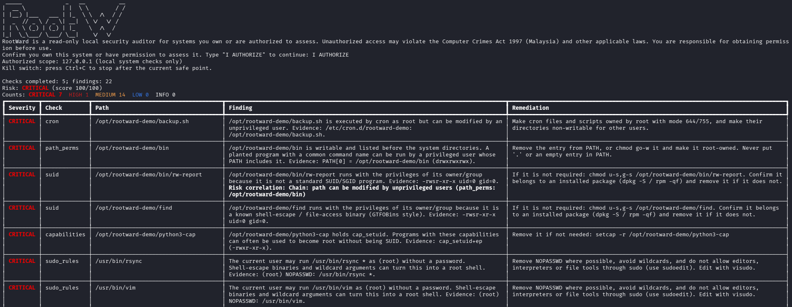
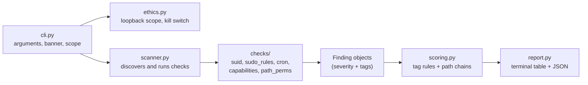

# RootWard

**A read-only Linux privilege-escalation auditor.**

RootWard inspects the local machine for misconfigurations that let an ordinary user become root: SUID/SGID binaries, risky `sudo` rules, writable cron jobs, dangerous file capabilities and writable directories in `PATH`. It scores each finding, links findings from different checks into attack chains, and explains how to fix every one. It never exploits anything, never changes the audited system (apart from writing its own report file in `output/`) and never sends data anywhere.

> **For authorized testing only.** Run it on systems you own or have written permission to assess. See the [Legal Disclaimer](#legal-disclaimer) and the [Rules of Engagement](#rules-of-engagement-roe).

| | |
|---|---|
| **Course** | IKB31603 Ethical Hacking, UniKL MIIT (October 2026) |
| **Team** | Sudo Squad |
| **Attack category** | 4. OS Specific Attack (privilege escalation checker / misconfiguration auditor) |
| **Language** | Python 3.10+ |
| **License** | MIT |

## Contents
1. [Features](#features)
2. [Attack lifecycle mapping](#attack-lifecycle-mapping)
3. [How it works](#how-it-works)
4. [Installation](#installation)
5. [Usage](#usage)
6. [Ethical considerations](#ethical-considerations)
7. [Rules of Engagement (RoE)](#rules-of-engagement-roe)
8. [Responsible disclosure](#responsible-disclosure)
9. [Legal disclaimer](#legal-disclaimer)
10. [Limitations](#limitations)
11. [Testing](#testing)
12. [Project structure](#project-structure)
13. [Team](#team)
14. [License](#license)

## Features

| Check ID | What it looks for | Examples of what is reported |
|---|---|---|
| `suid` | SUID/SGID binaries | A SUID-root `find` or `vim` (shell escape); a SUID file anyone can overwrite; a non-standard SUID program in `/tmp` or `/home` |
| `sudo_rules` | Risky entries from `sudo -n -l` | `NOPASSWD: ALL`; a wildcard rule; an editor or interpreter allowed through sudo; `env_keep` of `LD_PRELOAD` |
| `cron` | Cron jobs and scripts | A root cron job whose script a normal user can edit; a writable crontab; wildcard injection in `tar`/`rsync`/`chown`/`chmod` |
| `capabilities` | File capabilities | `cap_setuid`, `cap_sys_admin`, `cap_dac_override` and similar on an executable |
| `path_perms` | Directories in `$PATH` | A writable directory before the system directories; an empty or relative `PATH` entry |

Beyond the individual checks:

- **Chain scoring.** A writable directory that also holds a SUID binary, or a writable script that a root cron job runs, is escalated to CRITICAL. No single check can see this alone, so the scoring engine correlates findings across checks.
- **Remediation for every finding**, with the evidence that triggered it.
- **Risk score** from 0 to 100 and an overall rating (INFO, LOW, MEDIUM, HIGH, CRITICAL).
- **Coloured terminal table** (via `rich`, with a plain-text fallback) and a **labelled JSON report**.
- **False-positive control.** Standard distribution SUID programs are not reported, and a user editing their own crontab is not an escalation. The Debian default `root:staff 2775` on `/usr/local/bin` is reported as MEDIUM only and never chained to CRITICAL.
- **Add a check by adding a file.** Every module in `rootward/checks/` that subclasses `BaseCheck` is discovered automatically.



*A scan of the demo VM (Kali Rolling) after `demo_vm/setup_misconfig.sh`: the planted misconfigurations are reported as CRITICAL, and the `rw-report` finding carries the "Risk correlation: Chain" line. The image stops after the `vim` row. The full scan has 22 findings (7 CRITICAL, 1 HIGH, 14 MEDIUM); the 14 MEDIUM ones below it are Kali's own SUID programs (Kismet, `rsh-redone`, `pppd`) and are not shown.*

## Attack lifecycle mapping

RootWard belongs to the **post-compromise, local enumeration** stage: the moment after an attacker (or a tester) has a low-privileged shell and asks "how do I reach root?". It stops deliberately at the *finding*. It performs no exploitation and no persistence.

| Lifecycle stage | RootWard's role |
|---|---|
| Reconnaissance / intelligence gathering | Not covered (RootWard never touches the network) |
| **Enumeration and vulnerability analysis** | **Core purpose.** The five checks read permissions, sudo rules, cron files, capabilities and `PATH` |
| **Analysis and prioritisation** | **Scoring engine** ranks findings and links them into chains |
| Exploitation | Deliberately **excluded** (read-only by design) |
| Post-exploitation and persistence | Deliberately **excluded** |
| **Reporting and remediation** | **Terminal table, JSON report and a fix for every finding** |

MITRE ATT&CK mapping (tactic **TA0004 Privilege Escalation**):

| Check | Technique |
|---|---|
| `suid` | T1548.001 Abuse Elevation Control Mechanism: Setuid and Setgid |
| `sudo_rules` | T1548.003 Abuse Elevation Control Mechanism: Sudo and Sudo Caching |
| `cron` | T1053.003 Scheduled Task/Job: Cron |
| `capabilities` | T1548 Abuse Elevation Control Mechanism (file capabilities have no dedicated sub-technique) |
| `path_perms` | T1574.007 Hijack Execution Flow: Path Interception by PATH Environment Variable |


## How it works



Every check returns a list of `Finding` objects. A finding carries a **severity**, the **path** that matters and a set of **tags** from a shared vocabulary (`suid`, `root-owned`, `world-writable`, `cron`, `script-writable`, `sudo-nopasswd`, ...). The scoring engine works on those tags in two ways:

1. **Tag rules.** One finding with a dangerous combination of tags is escalated. For example `cron` + `root-owned` + `script-writable` becomes CRITICAL: "root cron job runs a script that unprivileged users can modify".
2. **Path chains.** If a path that unprivileged users can write is also a path executed with elevated rights (SUID, root cron, sudo NOPASSWD), or lies inside such a writable directory, both findings become CRITICAL and each records why.

Severity only ever goes up, and each escalation stores its reason, shown as "Risk correlation" in the output.

## Installation

RootWard audits **Linux**. Use a Linux machine or VM that you own. It follows Debian/Kali conventions and its test suite has been run on Ubuntu 26.04 under WSL. Windows is not supported for scanning, and the tests for the checks need a Linux system (see [Testing](#testing)).

```bash
git clone https://github.com/muhammadakidtaqiuddin-coder/PROJECT-ROOTWARD.git
cd PROJECT-ROOTWARD
python3 -m venv .venv
source .venv/bin/activate
pip install -r requirements.txt     # installs rich
```

Python 3.10 or newer is required. If `rich` is not installed, RootWard falls back to plain-text output.

## Usage

```bash
# Show all options
python -m rootward --help

# List the available checks and exit
python -m rootward --list-checks

# See which checks would run, without touching the system
python -m rootward --dry-run

# Run every check against this machine (asks you to type I AUTHORIZE first)
python -m rootward

# Run only some checks
python -m rootward --checks suid,cron
```

| Option | Meaning |
|---|---|
| `--scope ADDR` | Authorized scope marker. Loopback only (`127.0.0.1` or `::1`); default `127.0.0.1` |
| `--checks IDS` | Comma-separated check IDs to run (default: all) |
| `--dry-run` | List the checks that would run without inspecting the system |
| `--list-checks` | List available checks and exit |
| `--output DIR` | Folder for the local JSON report (default: `output/`) |
| `--no-report` | Show terminal results without writing a JSON report |

A real scan stops at a prompt and only continues if you type `I AUTHORIZE` exactly. `--dry-run` and `--list-checks` do not ask, because they inspect nothing.

**Run it as the account you want to audit.** `sudo_rules` asks `sudo -n -l` for the *current user's* rights (it never prompts for a password), and the filesystem checks report what an ordinary user could abuse. The filesystem checks give the same answer whether you run as root or not, because writability is judged from permission bits and not from who runs the scan. `sudo_rules` is the exception: as root, `sudo -n -l` lists every right, so it reports differently from a normal account.

The findings table needs a terminal at least 100 columns wide. On a narrower terminal RootWard prints each finding as a short block instead, so the output stays readable. Use 120 columns or more when recording a demo.

**Exit codes**

| Code | Meaning |
|---|---|
| 0 | Scan completed |
| 1 | Scan completed but at least one check reported an error |
| 2 | Scope rejected (not a loopback address), bad arguments, or the `I AUTHORIZE` confirmation was not given |
| 130 | Stopped by the kill switch (partial results are still shown) |

**Example output** (abridged)

```
Checks completed: 5; findings: 2
Risk: CRITICAL (score 100/100)

[CRITICAL] Writable PATH directory: /opt/rootward-demo/bin (path_perms)
  ...

[CRITICAL] SUID binary: /opt/rootward-demo/bin/rw-report (suid)
  Path: /opt/rootward-demo/bin/rw-report
  Finding: /opt/rootward-demo/bin/rw-report runs with the privileges of its owner/group because it is not a standard SUID/SGID program. Evidence: -rwsr-xr-x uid=0 gid=0.
  Remediation: If it is not required: chmod u-s,g-s /opt/rootward-demo/bin/rw-report. Confirm it belongs to an installed package (dpkg -S / rpm -qf) and remove it if it does not.
  Risk correlation: Chain: path can be modified by unprivileged users (path_perms: /opt/rootward-demo/bin)
```

On its own the SUID finding is only MEDIUM (a non-standard SUID program). Because the directory that holds it is writable by anyone, the scoring engine raises it to CRITICAL and records why in the "Risk correlation" line.

### JSON report

After a scan, RootWard saves a report to a local directory (default `output/`) named `rootward-<hostname>-<YYYYmmdd-HHMMSS>.json`. Use `--output DIR` to choose another folder or `--no-report` to disable JSON output. A dry run inspects nothing, so it never creates a report. The report holds the tool version, timestamp, hostname, scope, checks run and skipped, errors, whether the scan was aborted, the summary and every finding. The file is created owner-only (mode 0600), is never overwritten, and `output/` is excluded by `.gitignore`. This report is the only thing RootWard writes. If it cannot be written (for example the folder is not writable), RootWard still shows the scan results, then prints `could not save report: ...` and exits with code 1.

## Ethical considerations

RootWard is built so that running it by accident cannot cause harm.

| Guardrail | How it works | Why |
|---|---|---|
| Legal banner and authorization prompt | The CLI displays a notice citing the Computer Crimes Act 1997 and requires the user to type `I AUTHORIZE` before a real scan | Users are reminded that unauthorized access is an offence and must affirm permission |
| Safe default scope | Defaults to `127.0.0.1`; any non-loopback scope is rejected with exit code 2 | The tool audits only the machine it runs on and cannot be pointed at someone else's host |
| Read-only | Reads file metadata, extended attributes, cron files and `sudo -n -l`; never writes, deletes or exploits anything, except its own report file in `output/` | An audit tool must not change the system it audits |
| Dry run | `--dry-run` lists the checks without running them | Users can review what will happen first |
| Kill switch | `Ctrl+C` (SIGINT) or SIGTERM stops at the next safe point and returns partial results (exit 130) | A clean abort at any time |
| No network, no exfiltration | The tool opens no network connection and sends nothing out | Findings describe a machine's weaknesses and must stay on it |
| Local, labelled output | Reports go only to a local directory, labelled with hostname and time, mode 0600, git-ignored | Clear audit trail and no accidental commit of sensitive findings |
| Filesystem limits | `/proc`, `/sys`, `/dev`, `/run` and other mounted filesystems are not walked | Avoids slow or intrusive scans |

## Rules of Engagement (RoE)

These rules apply to anyone who runs RootWard.

**Authorized scope**
- Only machines you own, or machines for which you hold **written authorization** from the owner (for example your own lab VM).
- The tool enforces a loopback scope. Treat that as a technical limit, not as permission: you must still be authorized for the machine it runs on.

**Time windows**
- Run scans only inside the window the system owner approved. For this coursework, that means your own test VM during your own working time.
- Avoid production systems in business hours. The filesystem checks read many files and can add I/O load.

**Permitted techniques**
- Read-only local enumeration with the five built-in checks, as the user account being audited.
- Reviewing the findings and applying the suggested remediation **yourself**, on a system you are allowed to change.

**Prohibited actions**
- Running RootWard, or using its findings, against any system without explicit written authorization.
- Exploiting a finding (for example replacing a writable SUID binary or editing a root cron script) on a system you do not own.
- Modifying RootWard to scan other hosts, send data out, hide its activity or bypass the scope check or banner.
- Sharing or publishing reports that expose a third party's configuration.

**Emergency stop**
- Press `Ctrl+C` to stop at the next safe point. Remaining checks are skipped and partial results are kept.
- Send `SIGTERM` (`kill <pid>`) for the same clean stop from another terminal.
- RootWard changes nothing on the audited system, except its own report file in `output/`, so there is nothing to roll back after a stop (delete that file if you do not want it). If a stop is needed because of an unexpected effect, tell the system owner at once.

## Responsible disclosure

There are two situations.

**1. You find a weakness in RootWard itself** (for example a way to bypass the scope check, make it write outside the output directory, or crash it on crafted input). Follow [SECURITY.md](SECURITY.md): report it privately to the maintainers using GitHub private vulnerability reporting, do not open a public issue first, and allow reasonable time to fix it before disclosing.

**2. RootWard reveals a weakness on a system that is not yours.** You should not be running it there without authorization. If you came across the issue legitimately, tell the owner or administrator privately, describe the finding and its fix, give them reasonable time to act, and do not publish details until it is resolved. Do not exploit the weakness to "prove" it.

## Legal disclaimer

RootWard is a read-only local security auditor for systems you own or are authorized to assess. **Unauthorized access to computer systems may violate the Computer Crimes Act 1997 (Act 563) of Malaysia and other applicable laws.** Before a real scan, the CLI asks you to type `I AUTHORIZE`; that confirmation does not grant permission. You are responsible for obtaining permission before use. The authors accept no liability for misuse or for damage resulting from the use of this tool. It is provided for education and authorized security assessment, "as is", without warranty.

## Limitations

- **Linux only.** The checks rely on POSIX permissions, extended attributes and Linux cron/sudo paths. Windows and macOS are not supported for scanning.
- **Sudo rules need non-interactive sudo.** `sudo -n -l` shows only the current user's rights and fails if a password is required; in that case RootWard reports an INFO finding instead of guessing. It does not read `/etc/sudoers` directly.
- **Unprivileged runs cannot read everything.** Other users' crontabs in the spool and some directories are unreadable without root. Those parts are skipped or reported as check issues.
- **Standard-binary list is Debian-oriented.** A normal SUID program on another distribution may be reported as "not a standard program" (MEDIUM). There is no package verification (`dpkg -S`, `rpm -qf`) yet.
- **Heuristics, not proof.** A finding means a configuration is *risky*, not that it has been exploited. GTFOBins-style matching uses a built-in subset of known binaries.
- **Not covered:** kernel exploits, systemd timers, `at` jobs, writable service files, NFS `no_root_squash`, container escapes and credentials left in files.
- **Filesystem scope.** Filesystem checks walk a fixed set of roots (`/usr`, `/bin`, `/sbin`, `/opt`, `/home`, `/tmp`, `/var`, `/srv`) and do not cross into other mounted filesystems.

## Testing

```bash
python -m unittest tests.test_checks tests.test_checks_review tests.test_scoring tests.test_report
```

- `test_checks` and `test_checks_review` exercise the five checks and the permission logic. They need **Linux** (or WSL).
- `test_scoring` covers the tag rules, path chains, ordering, risk score and tag vocabulary.
- `test_report` covers the JSON report (labelling, hostname sanitising, no overwrite) and the terminal output.

Tests write only to temporary directories, never to `output/`.

## Project structure

```
rootward/
  cli.py          command-line interface, banner, kill-switch signals
  ethics.py       disclaimer, loopback scope validation, abort flag
  scanner.py      discovers and runs checks, isolates failures
  scoring.py      tag rules, path chains, risk score
  models.py       Severity and Finding
  report.py       terminal table and JSON report
  checks/
    base.py         BaseCheck contract
    _common.py      shared read-only helpers
    suid.py  sudo_rules.py  cron.py  capabilities.py  path_perms.py
tests/            unit tests
output/           local reports (git-ignored)
docs/             extra documentation
```

## Team

**Sudo Squad**, IKB31603 Ethical Hacking.

| Role | Member | Responsibility |
|---|---|---|
| A. Core developer | Akid | models, scanner, scoring |
| B. Checks developer | Haziq | the five checks, demo VM |
| C. Ethics, CLI and repo | Anam | banner, scope, CLI, release |
| D. Output, tests and docs | Faris | report output, tests, README, SECURITY, report |

## License

Released under the [MIT License](LICENSE).
